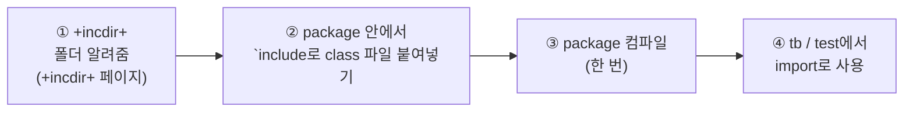

# `include / import / export

> **`` `include``는 복붙, `import`는 이름표 빌려 쓰기.** 원칙은 **"include는 한 곳에서, 공유는 import로"**: package 안에서 `` `include``로 class 파일을 붙여넣어 한 번 컴파일하고, tb / test에서는 `import`로 가져다 쓴다.

---

## 1. 한눈에 비교

| | 무엇 | 언제 | 한마디로 |
| --- | --- | --- | --- |
| `` `include`` | 파일 내용을 그 자리에 복사·붙여넣기 | 컴파일 전 (전처리) | 복붙 |
| `import` | 컴파일된 package 안의 이름을 보이게 함 | 컴파일 중 | 이름표 빌려 쓰기 |

!!! tip "`` `include``할 파일을 찾는 경로"
    `` `include``할 파일이 어느 폴더에 있는지 알려주는 컴파일 옵션은 [+incdir+](incdir.md) 페이지 참고.

---

## 2. `include

```systemverilog
package axi_pkg;
  `include "axi_item.sv"   // 이 줄이 axi_item.sv 내용으로 통째로 바뀜
  `include "axi_driver.sv"
endpackage
```

같은 파일을 두 번 include하면 같은 class가 두 번 정의돼서 에러가 난다. 이를 막기 위해 **include guard**를 사용한다.

```systemverilog
`ifndef AXI_ITEM_SV   // 이 매크로가 아직 정의되지 않았으면 `endif까지의 코드를 남김 (전처리)
`define AXI_ITEM_SV
class axi_item; ... endclass
`endif
```

```text
1번째 include : AXI_ITEM_SV 미정의 → `define 하고 class 정의 남김
2번째 include : AXI_ITEM_SV 이미 정의됨 → `endif까지 통째로 건너뜀
```

---

## 3. import

```systemverilog
import axi_pkg::axi_item;  // 하나만
import axi_pkg::*;         // 전부 (* = 와일드카드)
axi_pkg::axi_item it1;     // import 없이 풀네임은 항상 가능
```

- `::`는 **scope resolution** 연산자로 "소속::이름"을 뜻한다. (C++ `std::`와 같은 개념)
- package는 **한 번만 컴파일**되고, 여러 곳에서 import해도 실체는 하나다. (복사가 아님)

!!! warning "`::*`의 이름 충돌"
    `::*`는 편하지만 두 package에 같은 이름이 있으면 모호해진다. `import pkg::이름;`으로 지정하거나 `pkg::이름`으로 직접 붙여 쓴다.

---

## 4. import의 범위

> import는 **적은 자리(scope)에서만** 효과가 있고, **다른 곳으로 저절로 퍼지지 않는다.** 아래 5가지 규칙으로 정리된다.

| # | 규칙 | 한 줄 요약 |
| --- | --- | --- |
| 4.1 | scope 안에서만 유효 | 적은 scope 밖에서는 안 보임 |
| 4.2 | 파일 맨 바깥은 위험 | `$unit` scope → 툴·옵션마다 결과가 다름 |
| 4.3 | 전달 안 됨 (non-transitive) | 친구의 친구는 자동으로 내 친구가 아님 |
| 4.4 | 직접 선언한 이름이 우선 | `::*`는 약한 가져오기 |
| 4.5 | class 본문 안에는 불가 | 감싸는 package / module에 적기 |

### 4.1 scope 안에서만 유효

import는 **적은 scope**(module / interface / program / package / function / task / begin-end) 안에서만 유효하다. 다른 module에서 쓰려면 그 module에서 **따로 import**해야 한다.

```systemverilog
module tb;
  import axi_pkg::*;
  axi_item it;          // ✓ tb 안에서는 보임
endmodule

module monitor;
  axi_item it;          // ✗ 에러: monitor에서는 import하지 않음
endmodule
```

```text
┌─ module tb ──────────────┐   ┌─ module monitor ─────────┐
│ import axi_pkg::*;       │   │ (import 없음)            │
│ axi_item  ✓              │   │ axi_item  ✗              │
└──────────────────────────┘   └──────────────────────────┘
         import 효과는 이 상자 밖으로 나가지 않음
```

### 4.2 파일 맨 바깥은 위험 (`$unit`)

module / package 밖, **파일 맨 바깥**에 적은 import는 `$unit` scope에 들어간다. `$unit`의 범위는 툴과 컴파일 옵션(파일들을 한 단위로 컴파일하는지, 파일마다 따로 컴파일하는지)에 따라 달라서, **다른 파일에 보이기도 하고 안 보이기도 한다.**

```systemverilog
// a.sv
import axi_pkg::*;      // ⚠ 파일 맨 바깥 → $unit scope
module dut; ... endmodule

// b.sv
module tb;
  axi_item it;          // 툴·옵션에 따라 보이기도 / 에러가 나기도 함
endmodule
```

!!! tip "권장"
    import는 항상 **module / package 안에** 적는다.

### 4.3 전달 안 됨 (non-transitive)

`b_pkg`가 `a_pkg`를 import해도, tb에서 `b_pkg`만 import하면 **`a_pkg` 것은 안 보인다.**

```systemverilog
package a_pkg;  typedef int a_t;  endpackage

package b_pkg;
  import a_pkg::*;      // b_pkg 안에서만 a_t가 보임
  typedef a_t b_t;
endpackage

module tb;
  import b_pkg::*;
  b_t x;                // ✓ b_pkg 것
  a_t y;                // ✗ 에러: a_pkg 것은 전달되지 않음
endmodule
```

```text
  a_pkg ◀── import ── b_pkg ◀── import ── tb
                                          └─ a_pkg 것은 안 보임 ✗
  (친구의 친구는 자동으로 내 친구가 아님)
```

tb에서 `a_t`도 쓰려면 `import a_pkg::*;`를 tb에 따로 적거나, `b_pkg`에서 [export](#5-export)해 준다.

### 4.4 직접 선언한 이름이 우선

`::*`는 "**여기에 없으면 거기서 찾아봐**" 정도의 약한 가져오기다. 같은 scope에 직접 선언한 이름이 있으면 그쪽이 쓰인다.

```systemverilog
package cfg_pkg;  int timeout = 100;  endpackage

module tb;
  import cfg_pkg::*;
  int timeout = 5;      // 직접 선언
  initial $display(timeout);           // 5   (직접 선언한 것)
  initial $display(cfg_pkg::timeout);  // 100 (package 것은 풀네임으로)
endmodule
```

!!! warning "이름을 지정한 import는 다르다"
    `import cfg_pkg::timeout;`처럼 **이름을 지정해** 가져온 뒤 같은 이름을 직접 선언하면 충돌로 에러가 난다. 약한 가져오기는 `::*`일 때만이다.

### 4.5 class 본문 안에는 불가

class 본문 안에는 import를 적을 수 없다. class를 **감싸는 package / module**에 적는다.

```systemverilog
class my_driver;
  import axi_pkg::*;    // ✗ 에러: class 본문 안
endclass

package my_pkg;
  import axi_pkg::*;    // ✓ 감싸는 package에 적기
  class my_driver;
    axi_item it;        // ✓ 보임
  endclass
endpackage
```

---

## 5. export

내가 import한 것을 **나를 import하는 쪽에도 다시 내보내 준다.** 즉 친구의 친구도 볼 수 있게 한다.

```systemverilog
package b_pkg;
  import a_pkg::*;
  export a_pkg::*;
endpackage

module tb;
  import b_pkg::*;  // a_pkg 것도 보임
endmodule
```

```text
export 사용 시:

  a_pkg ◀── import + export ── b_pkg ◀── import ── tb
                                                    └─ a_pkg 것도 보임 ✓
```

- **용도**: 여러 하위 package를 묶어서 "이것 하나만 import하면 됨"으로 제공 (VIP 최상위 pkg)
- **package 안에서만** 사용 가능하고, 내보낼 수 있는 건 **그 package가 import한 것뿐**이다.

!!! warning "툴 차이"
    `export a_pkg::*`는 툴마다 동작이 다를 수 있다. `export *::*;` 또는 `export a_pkg::a_t;`처럼 지정한다.

---

## 6. 실무 함정

!!! warning "같은 파일을 두 package에서 include"
    같은 class 파일을 두 package에서 각각 `` `include``하면 `a_pkg::axi_item`과 `b_pkg::axi_item`은 **서로 다른 타입**이 된다. handle 대입 시 type mismatch가 난다.

    **원칙: include는 한 곳에서, 공유는 import로.**

---

## 7. 전체 흐름


