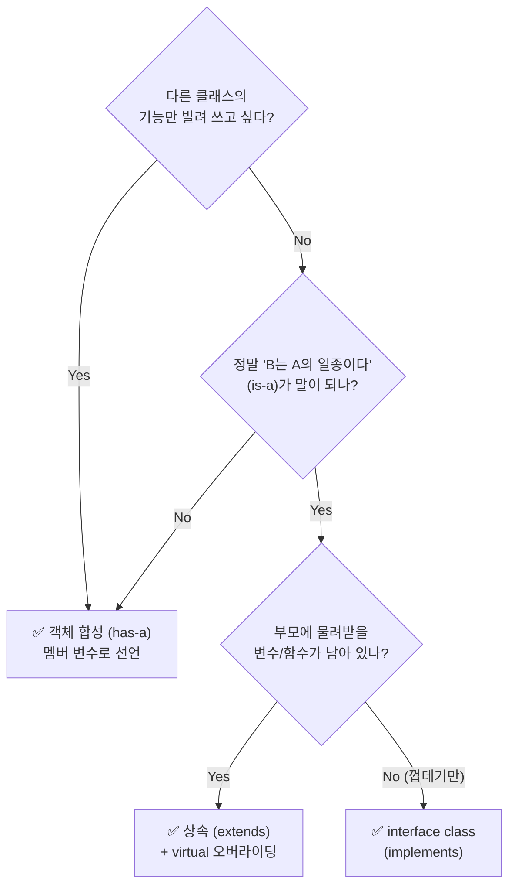

# 상속이 꼭 필요한 경우!

> **"기능 하나 빌려 쓰려고 `extends` 하지 마라."**
> 상속(`is-a`)은 **코드 재사용 + 다형성(오버라이딩)** 이 둘 다 필요할 때만 쓰고, 기능만 빌려 쓸 땐 **부품으로 넣고(`has-a`, Composition)**, 물려줄 코드가 하나도 없을 땐 **`interface class`** 로 규격만 맞춘다.

---

## 1. 한눈에 보는 3가지 선택지

| 구분 | 관계 | 문법 | 언제 쓰나 | TB 예시 |
|------|------|------|-----------|---------|
| **상속** | `is-a` (~는 ~의 일종이다) | `class B extends A;` | 부모 코드 **재사용** + **오버라이딩(다형성)** 둘 다 필요 | `BadCrcPkt extends BasePkt` |
| **객체 합성 (Composition)** | `has-a` (~는 ~를 부품으로 가진다) | `A a_inst = new();` (멤버 변수) | 다른 클래스의 **기능만 빌려 쓸 때** | Driver/Scoreboard 안의 `CrcCalc crc_eng;` |
| **interface class** | `implements` (규격만 맞춘다) | `interface class I; pure virtual ...` | 물려줄 코드가 **0줄**, 이름(규격)만 통일해서 다형성만 쓰고 싶을 때 | `AxiBfm`, `ApbBfm implements Resettable` |



---

## 2. 비유: 자동차·비행기에 "엔진" 달기

**상황** — `Engine` 클래스에 `시동걸기()` 기능이 이미 있다. `Car`와 `Airplane` 둘 다 `시동걸기()`가 필요하다.

#### ① ❌ 잘못된 방법 — 기능 쓰려고 상속

```systemverilog
class Car      extends Engine;  // ❌ "자동차는 엔진이다(?)"
class Airplane extends Engine;  // ❌ "비행기는 엔진이다(?)"
```

!!! warning "왜 나쁜가"
    - 말부터 이상하다. 자동차는 엔진 **자체**가 아니라 엔진을 **가진** 탈것이다.
    - 상속으로 묶이면 `Engine`을 조금만 고쳐도 `Car`, `Airplane`이 전부 영향을 받는다.

#### ② ✅ 올바른 방법 — 부품으로 넣기 (Composition)

```systemverilog
class Car;
  Engine eng = new();             // ✅ "자동차는 엔진을 부품으로 가진다" (has-a)
  function void drive();
    eng.시동걸기();                // 부품의 기능을 호출해서 재사용
  endfunction
endclass

class Airplane;
  Engine eng = new();             // ✅ 비행기도 엔진을 부품으로 가진다
  function void fly();
    eng.시동걸기();                // 똑같이 재사용
  endfunction
endclass
```

```text
 [상속: is-a]                      [합성: has-a]

   ┌────────┐                     ┌──────────────┐   ┌──────────────┐
   │ Engine │                     │ Car          │   │ Airplane     │
   └───▲────┘                     │ ┌──────────┐ │   │ ┌──────────┐ │
       │ extends                  │ │ Engine   │ │   │ │ Engine   │ │
   ┌───┴───┐  ┌──────────┐        │ └──────────┘ │   │ └──────────┘ │
   │  Car  │  │ Airplane │        └──────────────┘   └──────────────┘
   └───────┘  └──────────┘          엔진은 "부품"으로 안에 들어 있음
   "자동차는 엔진이다(?)"
```

!!! tip "한 줄 요약"
    단순히 `시동걸기()`를 같이 쓰고 싶다고 자동차를 엔진의 자식(`extends Engine`)으로 만들지 말고, 자동차 **안에 엔진을 부품(`Engine eng;`)으로** 넣어서 써라.

---

## 3. TB 실전 ① — 합성: `CrcCalc`를 Driver와 Scoreboard가 같이 쓰기

패킷을 보낼 때 **Driver**도 CRC를 붙여야 하고, **Scoreboard**도 기대값 비교를 위해 같은 CRC 계산이 필요하다.

```systemverilog
// 공통 부품 클래스
class CrcCalc;
  function bit [7:0] calc(bit [31:0] data);
    return ^data;                      // (예시) CRC 계산
  endfunction
endclass
```

#### ① ❌ 나쁜 예 — 재사용하려고 상속

```systemverilog
// ❌ 문법적으로 불가능: SV는 다중 상속이 안 된다.
//    my_driver는 이미 uvm_driver를 extends 해야 하므로 CrcCalc를 또 extends 할 수 없다.
class my_driver extends uvm_driver;    // + CrcCalc ??? → 불가

// ❌ UVM을 안 써서 억지로 상속해도 의미가 이상하다.
class my_driver     extends CrcCalc;   // "드라이버는 CRC 계산기다(?)"
class my_scoreboard extends CrcCalc;   // "스코어보드는 CRC 계산기다(?)"
```

#### ② ✅ 좋은 예 — 부품으로 선언 (has-a)

```systemverilog
// [Driver] 버스에 실어 보낼 때 CRC 계산기를 부품으로 사용
class my_driver extends uvm_driver #(my_item);   // ← 진짜 상속 (is-a: 드라이버의 일종)
  CrcCalc crc_eng;                                // ✅ 부품으로 가진다 (has-a)

  function void build_phase(uvm_phase phase);
    crc_eng = new();                              // 부품 생성
  endfunction

  task send_pkt(my_item tr);
    vif.data <= tr.data;
    vif.crc  <= crc_eng.calc(tr.data);            // 부품 함수 호출 → 코드 재사용
  endtask
endclass

// [Scoreboard] 모니터링된 패킷의 CRC 검사에도 같은 부품 재사용
class my_scoreboard extends uvm_scoreboard;
  CrcCalc crc_eng;                                // ✅ 여기서도 has-a

  function void build_phase(uvm_phase phase);
    crc_eng = new();
  endfunction

  function void check_pkt(my_item tr);
    bit [7:0] exp_crc = crc_eng.calc(tr.data);    // 똑같은 코드 100% 재사용
    if (tr.crc !== exp_crc)
      `uvm_error("SB", "CRC Mismatch!")
  endfunction
endclass
```

| 코드 | 관계 | 이유 |
|------|------|------|
| `extends uvm_driver` | **상속 (is-a)** | `my_driver`는 진짜 UVM 드라이버의 일종이고, 부모의 `run_phase()` 등을 오버라이딩(다형성)해서 쓴다 |
| `CrcCalc crc_eng;` | **합성 (has-a)** | `calc()` 기능만 빌려 쓰는 것 → 멤버 변수로 선언해서 `crc_eng.calc()` 호출 |

!!! note "이미 매일 쓰고 있는 합성"
    `env` 안에 `agent`, `scoreboard`를 멤버 변수로 선언해서 넣는 것도 전부 **객체 합성(Composition)** 이다.

---

## 4. TB 실전 ② — 상속이 맞는 경우: `BasePkt` → `BadCrcPkt`

UVM 기본 클래스를 빼고 TB에서 상속을 가장 깔끔하게 쓰는 대표 예시는 **정상 패킷을 상속받아 에러 주입 패킷을 만드는 것**이다. 상속의 두 조건(**① 코드 재사용 + ② 다형성/오버라이딩**)을 모두 만족한다.

#### ① 부모 — 정상 패킷

```systemverilog
class BasePkt;
  rand bit [31:0] addr;
  rand bit [31:0] data;
  bit      [7:0]  crc;

  virtual function void calc_crc();   // virtual → 자식이 바꿀 수 있게
    crc = ^data;                       // 정상 CRC
  endfunction
endclass
```

#### ② 자식 — 에러 패킷

```systemverilog
class BadCrcPkt extends BasePkt;      // ✅ "에러 패킷도 패킷의 일종이다" (is-a)

  virtual function void calc_crc();   // 부모 함수를 오버라이딩
    super.calc_crc();                  // 부모의 정상 계산 코드 재사용
    crc = ~crc;                        // 마지막에 비트를 뒤집어 에러 주입!
  endfunction
endclass
```

#### ③ 다형성 — Driver 코드는 한 줄도 안 바뀐다

```systemverilog
task send(BasePkt pkt);               // 부모 타입 핸들 하나로 둘 다 받는다
  void'(pkt.randomize());
  pkt.calc_crc();                     // BasePkt   → 정상 CRC
                                      // BadCrcPkt → 틀린 CRC (자동 선택)
  vif.data <= pkt.data;
  vif.crc  <= pkt.crc;
endtask
```

| 체크 포인트 | `BadCrcPkt` |
|-------------|-------------|
| `is-a` 관계가 말이 되나? | ✅ 에러 패킷도 패킷의 일종 |
| 코드 재사용이 있나? | ✅ `addr`, `data`, 기본 계산 로직을 물려받음 |
| 다형성(오버라이딩)을 쓰나? | ✅ 같은 `send(BasePkt pkt)`에 넣어도 객체에 따라 `calc_crc()`가 다르게 동작 |

!!! tip "진짜 상속을 써야 하는 순간"
    기존 패킷/시퀀스의 **90%는 그대로** 쓰고, 특정 동작이나 `constraint` **10%만 바꿔서 같은 자리에 끼워 넣고 싶을 때.**

---

## 5. 함수를 통째로 오버라이딩하면 상속 쓰면 안 되나?

???+ question "Q. `calc_crc()`를 `super` 없이 전부 덮어쓰면 재사용이 없으니 상속을 쓰면 안 되는 거지?"
    **아니다.** 판단 기준은 함수 하나가 아니라 **클래스 전체**다. 다른 변수/함수(`addr`, `data`, `pack()`, `print()` …)를 그대로 물려받아 쓰고 있다면 상속이 맞다.

#### ① ✅ 상속 OK — 함수 하나는 통째로 바꿔도 나머지를 재사용

```systemverilog
class BasePkt;
  rand bit [31:0] addr, data;
  bit      [7:0]  crc;

  function void pack(); /* ... */ endfunction   // ← 자식이 그대로 재사용
  virtual function void calc_crc();
    crc = ^data;
  endfunction
endclass

class ZeroCrcPkt extends BasePkt;
  // super 없이 통째로 덮어썼지만 addr/data/pack()은 재사용 중 → OK
  virtual function void calc_crc();
    crc = 8'h00;                                 // 무조건 0으로 강제
  endfunction
endclass
```

#### ② ✅ interface class — 물려줄 코드가 0줄일 때

AXI BFM과 APB BFM이 `reset_bus()`라는 **이름만** 맞추고 싶은 경우. 신호가 완전히 달라서 부모에 공통 코드를 쓸 수 없다.

```systemverilog
// ❌ 재사용할 코드가 1줄도 없는데 일반 클래스 상속
class BaseBfm;
  virtual task reset_bus();
    // AXI와 APB는 신호가 달라 공통으로 쓸 코드가 없음 → 빈 껍데기
  endtask
endclass

// ✅ 순수 규격(껍데기)만 정의하는 interface class
interface class Resettable;
  pure virtual task reset_bus();     // "코드는 안 줄 테니 이름만 맞춰서 각자 새로 짜라"
endclass

class AxiBfm implements Resettable;
  virtual task reset_bus();
    vif.awvalid <= 0; vif.wvalid <= 0;   // AXI 전용으로 100% 새로 작성
  endtask
endclass

class ApbBfm implements Resettable;
  virtual task reset_bus();
    vif.psel <= 0; vif.penable <= 0;     // APB 전용으로 100% 새로 작성
  endtask
endclass
```

| 상황 | 선택 |
|------|------|
| 물려받아 쓸 변수/함수가 남아 있다 (함수 하나는 통째로 오버라이딩해도) | **상속 (`extends`)** |
| 물려받을 코드가 0줄, 함수 이름만 통일해서 다형성만 쓰고 싶다 | **`interface class` (`implements`)** |
| 다른 클래스의 기능만 빌려 쓰고 싶다 | **객체 합성 (멤버 변수)** |

---

## 6. 핵심 정리

!!! tip "3줄 요약"
    - **합성 (has-a)** : 기능만 빌려 쓸 땐 `CrcCalc crc_eng;`처럼 **부품으로 넣는다.**
    - **상속 (is-a)** : **재사용 + 오버라이딩(다형성)** 이 둘 다 있을 때만 `extends`.
    - **interface class** : 물려줄 코드가 없고 **규격(함수 이름)만 통일**할 때 `implements`.

관련 페이지: [virtual method/class](../sv/virtual.md) · [객체 복사 (Shallow vs Deep Copy)](../sv/object-copy.md)
