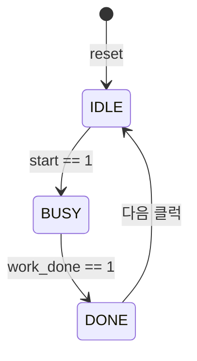

# RTL 기초 — 조합/순차 논리 & `=` vs `<=`

> 회로는 **조합(기억 없음) / 순차(기억 있음)** 두 종류. 코드는 `assign` / `always_comb` / `always_ff`로 쓰고, **`always_ff`엔 `<=`, `always_comb`엔 `=`**.

## 1. 두 기준을 먼저 구분하기

"combinational vs procedural"은 비교하는 짝이 아니다. 기준이 서로 다르다.

- **조합(combinational) vs 순차(sequential)** → **회로의 종류**
- **continuous(`assign`) vs procedural(`always` 블록)** → **코드를 쓰는 방식**

| | 회로 종류 | 기억 | 값이 바뀌는 시점 | 비유 |
|---|---|---|---|---|
| 조합 논리 | AND, OR, MUX, 덧셈기 | 없음 | 입력이 바뀌면 **바로** | 계산기 버튼 → 화면 |
| 순차 논리 | 플립플롭, 레지스터, 카운터, FSM | 있음 | **클럭 엣지에서만** | 사진기 셔터 |

두 기준을 합치면:

| 코드 | 쓰는 방식 | 만드는 회로 |
|---|---|---|
| `assign y = a & b;` | continuous (한 줄) | 조합 |
| `always_comb begin ... end` | procedural | 조합 |
| `always_ff @(posedge clk) ...` | procedural | 순차 |

→ procedural은 "**어떻게 쓰느냐**"일 뿐, 그걸로 조합 회로도 순차 회로도 만들 수 있다.

## 2. `assign` vs `always_comb`

**둘 다 조합 회로**를 만든다. 차이는 "얼마나 복잡한 걸 쓸 수 있느냐".

```systemverilog
// assign — 식 하나로 선을 연결
assign y   = a & b;
assign out = sel ? d1 : d0;   // 2:1 MUX
```

```systemverilog
// always_comb — 블록 안에 문장 여러 줄
always_comb begin
  out = d3;                // 기본값 먼저
  case (sel)
    2'd0: out = d0;
    2'd1: out = d1;
    2'd2: out = d2;
  endcase
end
```

| | `assign` | `always_comb` |
|---|---|---|
| 표현 | 식 하나 | `if`, `case`, 중간 변수, 여러 출력 |
| 래치 위험 | 없음 (항상 식이 연결돼 있음) | 모든 경우에 값을 안 주면 생김 |
| 언제 | 식 하나로 끝날 때 | 조건이 여러 개거나 `case`가 필요할 때 |

- 만들어지는 회로는 같다. 2:1 MUX를 `always_comb`에서 `if (sel) out = d1; else out = d0;`로 써도 동일.

## 3. latch (의도치 않은 래치) & 글리치(glitch)

래치 = **값을 기억하는 회로**. 조합 회로를 만들려다 실수로 "기억"이 들어간 상황.

```systemverilog
// ❌ sel=0일 때 y 값을 안 정함 → "이전 값 유지" → 래치 추론
always_comb begin
  if (sel)
    y = a;
end
```

```systemverilog
// ✅ 기본값을 먼저 주면 모든 경우에 값이 정해짐
always_comb begin
  y = '0;
  if (sel) y = a;
end
```

### 래치는 어디서만 생길까?

실수로 생기는 래치는 **조합 회로 블록(`always_comb`, `always @(*)`)에서만** 생긴다.

- **`assign`**: 항상 식이 연결돼 있어 조건을 빼먹을 수 없음 → 래치 안 생김.
- **`always_ff @(posedge clk)`**: `else`를 빼먹으면 래치가 아니라 **"이전 값을 유지하는 정상 플립플롭"(enable 달린 FF)**이 만들어진다 (`if (en) q <= d;`).
- **`always_comb`**: 원래 기억이 없어야 하는 조합 회로인데 `else`/`default`를 빼먹으면, 클럭도 없는데 이전 값을 기억해야 해서 **래치**가 만들어진다. (의도적으로 래치를 만들 땐 `always_latch` 사용)

### 의도치 않은 래치가 위험한 4가지 이유

1. **창문이 계속 열려 있음 (투명성 문제)**
   - 플립플롭은 클럭이 올라가는 "찰칵" 한 순간만 문을 여는 **사진기 셔터**지만, 래치는 조건(`sel=1`)이 맞는 동안 내내 열려 있는 **창문**이다.
   - `sel=1`인 동안 입력 `a`가 흔들리면 출력 `y`도 클럭과 무관하게 실시간으로 흔들리고, `sel=0`이 되는 순간 마지막 값이 그대로 갇혀 뒷단 회로가 오동작한다.
2. **글리치(glitch, 찰나의 가짜 신호)를 삼켜서 영구 저장함**
   - **글리치란?** 두 개 이상의 신호가 조합 회로를 거칠 때 선 길이(도착 시간) 차이로 출력이 잠깐 튀는 현상.
     - 예: `sel = p & q`에서 `p: 1→0`(느린 선), `q: 0→1`(빠른 선)로 동시에 바뀔 때, 원래 `sel`은 계속 `0`이어야 하지만 `q`만 먼저 도착한 찰나에 `p=1, q=1`이 되어 `sel`이 `0 → 1 → 0`으로 톡 튄다.
     - 단독 신호(외길)에서는 글리치가 생길 수 없고, **두 개 이상의 신호가 합쳐질 때만** 생긴다.
   - 플립플롭은 글리치가 다 가라앉은 뒤 **클럭 엣지(정각)**만 찍으므로 글리치를 무시한다. 반면 래치는 `sel` 선에 잠깐 튄 글리치에도 창문이 열렸다가 닫히면서 그 순간의 쓰레기 값을 영구 저장해 버린다.
3. **타이밍 검사(STA)가 어려워짐**
   - 플립플롭은 **정각 출발 → 정각 도착**하는 기차와 같아 "한 클럭 안에 도착하는가"를 계산(STA)하기 쉽다.
   - 래치는 창문이 열려 있는 동안 아무 때나 신호가 그냥 통과해 버려 출발선과 결승선의 경계가 흐려지고 타이밍 계산이 꼬인다.
4. **RTL 시뮬레이션에선 숨어 있다가 실제 칩에서만 터짐**
   - 일반 RTL 시뮬레이션은 모든 선의 이동 지연 시간을 **`0초`로 가정**하므로, 도착 시간 차이로 생기는 글리치가 아예 나타나지 않아 테스트가 100% PASS한다.
   - 실제 칩에는 물리적 선 길이 차이가 있어 글리치가 생기고, 시뮬레이션에선 한 번도 안 열렸던 래치 창문이 열리며 버그가 터진다.

### 실무 방지 규칙 3가지

1. **기억 소자는 무조건 `always_ff`(플립플롭)로만** 만든다 (데이터 선의 글리치는 클럭 엣지 전에 가라앉아 안전).
2. **`always_comb`에서는 래치가 절대 안 생기게** 맨 윗줄 기본값(`y = '0;`) 또는 `else`/`default`를 빠짐없이 채운다.
3. **방아쇠 핀(`clk`, `rst_n`)에는 절대 두 신호를 합친 조합 회로 출력을 꽂지 않고, 외길 단독 신호(PLL/FF 직출)만 연결**한다.
   - 동작을 켜고 끄고 싶을 때 `assign sub_clk = clk & en;`처럼 클럭에 조합 회로를 섞으면 클럭 자체에 글리치가 생겨 가짜 엣지로 오동작한다. (클럭을 직접 꺼야 할 땐 전용 부품인 **ICG** 사용)
   - 일반 RTL에서는 클럭은 외길 그대로 두고 `en`을 데이터 입구(`d` 쪽)로 보낸다:
     ```systemverilog
     // ❌ 금지: 클럭에 조합 회로 섞기 (클럭 글리치 발생)
     assign sub_clk = clk & en;

     // ✅ 정석: clk는 외길 그대로 두고, en은 데이터 쪽에서 처리
     always_ff @(posedge clk) begin
       if (en) q <= d;
     end
     ```

- 래치 vs 플립플롭 추가 참고 → [컴퓨터 구조 Unit 8 — Q4, Q5](../../computer-architecture/unit8-pipeline-hazard.md)

## 4. 순차 논리와 `always_ff`

기본 부품은 **D 플립플롭** (입력 `d`, 클럭 `clk`, 출력 `q`).

- `clk`가 0→1로 올라가는 순간(posedge) `d`를 찍어서 `q`에 저장.
- 그 외 시간엔 `d`가 바뀌어도 `q`는 그대로. (셔터를 누른 순간만 저장되는 사진기)

```systemverilog
always_ff @(posedge clk) begin
  q <= d;
end
```

```systemverilog
// 비동기 리셋 — 전원 직후 FF 값은 알 수 없으므로 시작 값을 정해줌
always_ff @(posedge clk or negedge rst_n) begin
  if (!rst_n) q <= '0;
  else        q <= d;
end
```

- "지금 몇 번째인지", "지금 어떤 상태인지"처럼 **과거를 기억해야 하는 건 전부 순차 논리** (카운터, 레지스터, FSM).
- 모든 FF가 같은 클럭에 맞춰 동시에 바뀌므로 회로 전체가 박자를 맞춰 움직인다.

## 5. `always` vs `always_ff` / `always_comb`

만들어지는 회로는 같을 수 있다. 차이는 **의도를 선언하고, 도구가 그걸 검사해 준다**는 것.

```verilog
// 옛 Verilog — always 하나로 FF도, 조합도, 래치도 다 만듦 → 실수해도 조용히 넘어감
always @(posedge clk) q <= d;     // 플립플롭
always @(*)           y = a & b;  // 조합 회로
```

`always_ff`로 쓰면 도구가 잡아주는 것:

- 클럭 엣지(`posedge`/`negedge`) 없이 쓰면 경고/에러
- 블록 안에서 FF가 아닌 것(조합, 래치)이 만들어지면 알림
- 같은 변수를 다른 블록에서도 구동하면 에러

| 블록 | 용도 |
|---|---|
| `always_ff` | 플립플롭 (순차) |
| `always_comb` | 조합 회로 |
| `always` | 회로가 아닌 곳, 예: TB 클럭 생성 `always #5 clk = ~clk;` |

## 6. `=` (blocking) vs `<=` (non-blocking)

### 이름의 뜻

- **blocking `=`**: 값이 바뀔 때까지 **다음 줄을 막고 기다림** → 다음 줄은 **바뀐 값**을 봄. (소프트웨어 변수와 같음)
- **non-blocking `<=`**: 값 넣기는 **나중으로 예약**만 하고 바로 다음 줄로 → 다음 줄은 **바뀌기 전 값**을 봄.

### 비유: 줄 서서 공 넘기기 (`always_ff`) vs 요리 레시피 (`always_comb`)

- **`always_ff`는 "단체 공 넘기기" (`<=`)**: A=🔴, B=🔵, C=🟢일 때 호루라기(클럭)가 울리면 **모두 동시에** 직전에 들고 있던 공을 넘겨야 한 칸씩 이동한다(B=🔴, C=🔵). 여기에 `=`를 쓰면 A→B가 즉시 바뀌어 C까지 한 번에 🔴가 날아가 버린다.
- **`always_comb`은 "요리 레시피" (`=`)**: 1번 줄에서 재료를 썰고(`tmp = a + b;`), 2번 줄에서 그 재료를 바로 볶아야 한다(`y = tmp * 2;`). 여기에 `<=`를 쓰면 `tmp` 갱신이 나중으로 미뤄져 2번 줄이 **아직 안 썬 옛날 `tmp`**로 계산해 틀린 답이 나온다.

```systemverilog
// <= : 시프트 레지스터 (FF 2개)
always_ff @(posedge clk) begin
  B <= A;
  C <= B;
end

// = : 한 칸씩 밀리는 동작이 깨짐
always_ff @(posedge clk) begin
  B = A;
  C = B;
end
```

| 시점 | `<=` 버전 (B, C) | `=` 버전 (B, C) |
|---|---|---|
| 시작 | 🔵, 🟢 | 🔵, 🟢 |
| 1번째 클럭 | 🔴, 🔵 | 🔴, 🔴 |

### 시뮬레이터 안에서 `<=`는 2단계

1. **읽기(Active)**: 클럭이 올라가면 모든 `<=`의 오른쪽 값을 먼저 읽어 메모. (모두 공을 꽉 쥐고 준비)
2. **쓰기(NBA)**: 그 시점 계산이 다 끝나면 메모한 값을 한꺼번에 왼쪽에 넣음. (하나, 둘, 셋에 동시에 넘기기)

### 줄 순서를 바꾸면?

```systemverilog
always_ff @(posedge clk) begin
  C <= B;
  B <= A;
end
```

- `<=`는 줄 순서를 바꿔도 **결과가 같다** (다 읽고 나서 한꺼번에 쓰니까).
- `=`는 줄 순서에 따라 결과가 달라진다.

### 조합 회로에 `<=`를 쓰면?

```systemverilog
always_comb begin
  tmp = a & b;
  y   = tmp | c;   // 방금 계산한 tmp를 바로 써야 함
end
```

여기서 `<=`를 쓰면 `y`가 갱신 전 `tmp`를 읽어 **한 순간 틀린 값**이 나온다 → 조합 회로엔 `=`.

### 하지 말 것

- 한 블록 안에서 `=`와 `<=`를 **섞어 쓰지 않기**. 언제 바뀌는지 헷갈려 버그가 생기고 리뷰도 어렵다.
- UVM Driver / Monitor에서 `<=`와 `=`를 구분해 쓰는 이유는 → [UVM Driver / Monitor에서의 Blocking(`=`) vs Non-blocking(`<=`)](../uvm/driver-monitor-blocking-nonblocking.md)

## 7. FSM (Finite State Machine, 유한 상태 머신) — 조합 + 순차의 대표 결합

FSM은 **"지금 어떤 상태(`state`)인지 기억하고 있다가, 조건이 들어오면 다음 상태(`next_state`)로 넘어가는 회로"**로, 컨트롤러의 핵심 두뇌다. 앞서 배운 `always_ff`와 `always_comb`을 세트로 묶어 만든다.



- **현재 상태(`state`)를 기억하고 클럭마다 넘어가는 부분** → 기억해야 하므로 **`always_ff` (`<=`)**
- **현재 상태와 입력(`start`, `work_done`)을 보고 다음 상태(`next_state`)를 계산하는 부분** → 계산만 하므로 **`always_comb` (`=`)**

### FSM 표준 코드 3덩어리 + 출력

```systemverilog
// 1) 상태 이름 정의 (숫자 대신 enum으로 가독성 확보)
typedef enum logic [1:0] {
  IDLE,
  BUSY,
  DONE
} state_t;

state_t state, next_state;

// 2) 현재 상태 기억 (순차 논리: always_ff + <=)
always_ff @(posedge clk or negedge rst_n) begin
  if (!rst_n) state <= IDLE;
  else        state <= next_state;
end

// 3) 다음 상태 계산 (조합 논리: always_comb + =)
always_comb begin
  next_state = state;  // ★ 기본값: 조건 안 맞으면 현재 상태 유지 (래치 원천 차단!)

  case (state)
    IDLE: if (start)     next_state = BUSY;  // start==1일 때만 BUSY로, 아니면 IDLE 유지
    BUSY: if (work_done) next_state = DONE;  // work_done==1일 때만 DONE으로
    DONE:                next_state = IDLE;
    default:             next_state = IDLE;
  endcase
end

// 4) 상태에 따른 출력 (상태만 보고 정해지면 Moore, 입력까지 같이 보면 Mealy)
assign busy_flag  = (state == BUSY);
assign done_pulse = (state == DONE);
```

- 만약 `if (start)`나 `if (work_done)` 조건 없이 `IDLE: next_state = BUSY;`만 쓰면, 아무 명령이 없어도 매 클럭 혼자 `IDLE → BUSY → DONE → IDLE`을 뺑뺑이 도는 회로가 된다. 상태가 넘어갈 **방아쇠 조건**으로 `if`를 넣는 것이다.
- 첫 줄에 `next_state = state;` 기본값을 깔아두었기 때문에 `if`의 `else`를 일일이 쓰지 않아도 **래치가 절대 생기지 않는다**.

### 검증 엔지니어가 FSM에서 확인하는 3가지

1. **모든 상태를 다 가봤는가? (State Coverage)** — 한 번도 안 가본 상태(예: `ERROR`)가 남으면 미검증.
2. **모든 화살표(전이)를 다 타봤는가? (Transition Coverage)** — 정상 경로뿐 아니라 취소/예외 화살표까지 모두 확인.
3. **가면 안 되는 길로 가거나 갇히지(deadlock) 않는가? (Assertion 감시)** — 예: `IDLE`에서 `BUSY`를 건너뛰고 `DONE`으로 점프하면 에러(→ [assertion (SVA)](assertion.md)).

## 8. 핵심 규칙 요약

- 조합/순차는 **회로 종류**, `assign`/procedural은 **쓰는 방식**.
- 식 하나면 `assign`, 조건이 많으면 `always_comb`.
- `always_comb`에선 **기본값 먼저** → 의도치 않은 래치 방지 (래치는 `always_comb`에서만 추론됨).
- 클럭/리셋 선에는 조합 회로를 섞지 않고 **외길 단독 신호**만 연결 (글리치 차단).
- 플립플롭은 `always_ff`, 조합은 `always_comb`, 그냥 `always`는 TB용.
- **`always_ff`엔 `<=`, `always_comb`엔 `=`**, 한 블록에서 섞지 않기.
- **FSM**은 상태 기억(`always_ff` + `<=`)과 다음 상태 계산(`always_comb` + `=`, 첫 줄 `next_state = state;`)의 결합.
