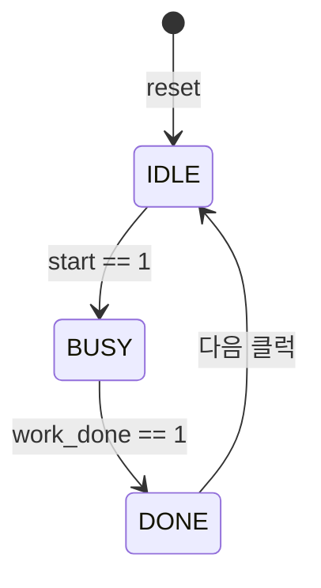

# FSM (Finite State Machine, 유한 상태 머신)

> **"지금 어떤 상태(`state`)인지 기억하고 있다가, 조건이 들어오면 다음 상태(`next_state`)로 넘어가는 회로"** — 순차 논리(`always_ff`)와 조합 논리(`always_comb`)를 세트로 묶어 만드는 컨트롤러의 핵심 두뇌.

---

## 1. FSM의 구조와 역할 분담



FSM은 앞서 배운 [조합 논리와 순차 논리](comb-seq-logic.md) 두 블록의 역할 분담으로 동작한다.

| 역할 | 쓰는 블록과 연산자 | 설명 |
| --- | --- | --- |
| **현재 상태(`state`) 기억** | **`always_ff` (`<=`)** | 클럭이 뛸 때마다 계산된 `next_state`를 `state` 플립플롭에 저장 |
| **다음 상태(`next_state`) 계산** | **`always_comb` (`=`)** | 현재 `state`와 입력(`start`, `work_done`)을 보고 다음에 어디로 갈지 즉시 계산 |
| **상태 출력 생성** | **`assign` / `always_comb`** | 현재 상태만 보고 정해지면 **Moore**, 입력까지 같이 보면 **Mealy** |

---

## 2. 실무 표준 코드 패턴 (3단 구성)

```systemverilog
// ① 상태 이름 정의 (숫자 대신 enum을 써야 파형에서 IDLE, BUSY 글자로 보임)
typedef enum logic [1:0] {
  IDLE,
  BUSY,
  DONE
} state_t;

state_t state, next_state;

// ② 현재 상태 기억 (순차 논리: always_ff + <=)
always_ff @(posedge clk or negedge rst_n) begin
  if (!rst_n) state <= IDLE;
  else        state <= next_state;
end

// ③ 다음 상태 계산 (조합 논리: always_comb + =)
always_comb begin
  next_state = state;  // ★ 기본값: 조건 안 맞으면 현재 상태 유지 (래치 원천 차단!)

  case (state)
    IDLE: if (start)     next_state = BUSY;  // start==1일 때만 BUSY로, 아니면 IDLE 유지
    BUSY: if (work_done) next_state = DONE;  // work_done==1일 때만 DONE으로
    DONE:                next_state = IDLE;
    default:             next_state = IDLE;
  endcase
end

// ④ 상태에 따른 출력
assign busy_flag  = (state == BUSY);
assign done_pulse = (state == DONE);
```

!!! tip "코드에서 꼭 챙겨야 할 2가지"
    - **왜 `case` 안에 `if (start)`를 넣을까?**
      `if` 조건 없이 `IDLE: next_state = BUSY;`만 쓰면, 아무 명령이 없어도 매 클럭 혼자 `IDLE → BUSY → DONE → IDLE`을 뺑뺑이 도는 회로가 된다. 상태가 넘어갈 **방아쇠 조건**으로 `if`를 넣는 것이다.
    - **왜 첫 줄에 `next_state = state;`를 먼저 쓸까?**
      맨 윗줄에 "아무 조건도 안 맞으면 지금 상태를 유지하라"는 기본값을 깔아두면, 아래 `if`문마다 일일이 `else next_state = state;`를 적지 않아도 **의도치 않은 래치(Latch)가 절대 생기지 않는다**.

---

## 3. 검증 엔지니어(DV)가 FSM에서 확인하는 3가지

| 점검 항목 | 확인 내용 | 검증 도구 |
| --- | --- | --- |
| **① State Coverage** | 정의된 모든 상태(`IDLE`, `BUSY`, `DONE`, `ERROR` 등)를 최소 한 번씩 다 가봤는가? | Coverage (FSM State) |
| **② Transition Coverage** | 상태 사이의 모든 화살표(정상 경로 + 취소/에외 경로)를 다 타봤는가? | Coverage (FSM Transition) |
| **③ 불법 전이 & Deadlock 감시** | 가면 안 되는 길(예: `IDLE → DONE` 점프)로 가거나, 특정 상태에 영원히 갇히지 않는가? | [Assertion (SVA)](assertion.md) |

```systemverilog
// FSM 전이 감시 Assertion 예시: IDLE에서 start가 뜨면 다음 클럭엔 반드시 BUSY여야 한다
assert property (@(posedge clk) disable iff (!rst_n)
  (state == IDLE && start) |=> (state == BUSY)
);
```
