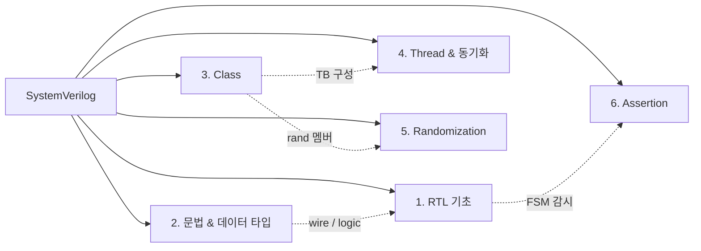

# SystemVerilog

> SystemVerilog(SV)는 하드웨어 설계와 검증에 모두 쓰이는 HDL/HVL 통합 언어다. 여기엔 일하면서 얻은 **문법 팁/노하우**를 6개 주제 폴더로 나눠 정리한다.

---

## 1. 구성

| 폴더 | 한 줄 요약 | 페이지 |
| --- | --- | --- |
| [1. RTL 기초](rtl/index.md) | 설계 쪽 기본기 — 조합/순차, 절차 블록, FSM, X/Z | [조합 / 순차 논리](rtl/comb-seq-logic.md) · [절차 블록](rtl/procedural-blocks.md) · [FSM](rtl/fsm.md) · [X propagation](rtl/x-propagation.md) · [X vs Z](rtl/x-vs-z.md) |
| [2. 문법 & 데이터 타입](syntax/index.md) | 자주 헷갈리는 문법·변수 수명 | [인덱스 부분 선택](syntax/indexed-part-select.md) · [static / automatic](syntax/static-automatic.md) · [wire / reg / logic](syntax/net-variable.md) |
| [3. Class](class/index.md) | TB 뼈대가 되는 class 문법 | [virtual method / class](class/virtual.md) · [객체 복사](class/object-copy.md) · [virtual class / interface](class/virtual-interface.md) |
| [4. Thread & 동기화](thread/index.md) | 병렬 프로세스 실행과 동기화 | [fork-join](thread/fork-join.md) |
| [5. Randomization](randomization/index.md) | 제약 랜덤화(constraint random) | [기본](randomization/basics.md) · [솔버](randomization/solver.md) · [Expression](randomization/expression.md) · [with / soft](randomization/with-soft.md) · [동적 제어](randomization/dynamic.md) · [분포 제어](randomization/distribution.md) |
| [6. Assertion (SVA)](sva/index.md) | 프로토콜·타이밍 규칙 자동 감시 | [기본](sva/basics.md) · [시퀀스 & 패턴](sva/sequence.md) · [property](sva/property.md) · [bind](sva/bind.md) |

---

## 2. 한눈에 보기

!!! tip "새 페이지 추가"
    새 팁은 알맞은 폴더에 `.md`를 만들고, 그 폴더의 `index.md` 표와 `mkdocs.yml`의 `nav`에 한 줄씩 등록한다.
