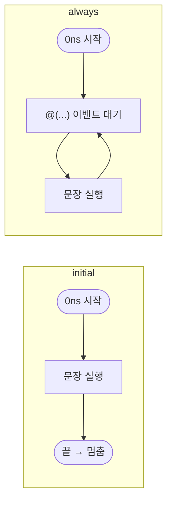

# 절차 블록 — `initial` / `always` / `assign` / `always_comb`

> `initial`·`always`는 **대본(procedural block)**: `initial`은 0ns에 **한 번만**, `always`는 끝나면 처음으로 돌아가 **무한 반복**. `assign`과 `always_comb`는 **같은 조합 회로**를 만들지만, 한 줄 연결이면 `assign`, `if`/`case`가 있으면 `always_comb`. `always_comb`엔 **감도 리스트를 쓰면 컴파일 에러**.

---

## 1. `initial` vs `always` — 한 번 vs 무한 반복

둘 다 위에서 아래로 실행되는 **대본(procedural block)**이다. 차이는 "끝까지 실행한 뒤 어떻게 되느냐"뿐이다.

| 블록 | 시작 시점 | 끝나면? | 주 용도 |
| --- | --- | --- | --- |
| **`initial`** | 0ns | **멈춤** (한 번만 실행) | TB 초기화, 자극(stimulus) 순서, 클럭 생성(`forever`) |
| **`always`** | 0ns | **처음으로 돌아가 다시 실행** (무한 반복) | 옛 Verilog RTL(FF/조합), TB 클럭 생성 |



### `always @(...)` — 이벤트가 올 때까지 멈춰서 기다림

괄호 안의 이벤트(**sensitivity list, 감도 리스트**)가 생길 때까지 멈춰 있다가, 생기면 블록을 한 번 실행하고 다시 기다린다.

| 코드 | 언제 깨어나나 | 만드는 회로 |
| --- | --- | --- |
| `always @(posedge clk)` | `clk`가 `0 → 1`로 올라갈 때 | **플립플롭** (순차) |
| `always @(*)` | 블록 안에서 **읽는 신호 전부** 중 하나라도 바뀔 때 | **조합 회로** |

- `*`는 "블록 안에서 읽는(오른쪽에 나오는) 신호 전부"를 뜻한다. 손으로 `@(a or b)`를 쓰다 하나를 빼먹는 실수를 막아 준다.
- SV에서는 같은 의도를 더 엄격하게 검사하는 `always_ff` / `always_comb`를 쓴다 → [조합 / 순차 논리 §5](comb-seq-logic.md#5-always-vs-always_ff-always_comb)

---

## 2. TB 클럭 생성 — 실무 패턴

```systemverilog
// ✅ 실무 선호: 초기값 + 토글을 한 블록에
initial begin
  clk = 0;
  forever #5 clk = ~clk;   // 5 time unit마다 뒤집힘 → 주기 10
end
```

```systemverilog
// ✅ 동작은 위와 동일
initial clk = 0;
always  #5 clk = ~clk;
```

| 방식 | 장점 |
| --- | --- |
| **`initial` + `forever`** | 초기값과 토글이 **한 블록**에 있어 한눈에 보임 / `clk = 0`을 빠뜨리는 실수 방지 / 시작 지연(`#3;`)을 앞에 넣기 쉬움 |
| **`initial` + `always`** | 동작은 동일. 단 초기화 줄을 따로 써야 함 |

!!! warning "clk 초기화를 빠뜨리면 영원히 `X`"
    `clk`(`logic`/`reg`)의 초기값은 `X`다. `always #5 clk = ~clk;`만 쓰면 `~X = X`이므로 **클럭이 영원히 `X`**로 남고, 그 클럭을 쓰는 FF도 전부 동작하지 않는다.

!!! tip "`always_comb`로는 클럭을 못 만든다"
    `always_comb` 안에는 `#` 지연을 쓸 수 없다(컴파일 에러). 지연 없이 `clk = ~clk`만 하면 시간이 흐르지 않는 **0ns 무한 루프**가 된다. 클럭은 항상 `initial` + `forever` 또는 `always #N`으로 만든다.

!!! warning "자주 틀리는 포인트 — `#5`는 5 cycle이 아니라 5 time unit"
    - `#5`는 **5 클럭 사이클이 아니라 5 × timescale 단위**다. `` `timescale 1ns/1ps``라면 **5ns**.
    - `always #5 clk = ~clk;`의 클럭 주기는 **10ns** (5ns마다 한 번 뒤집힘).
    - 이 `always`를 `initial #5 clk = ~clk;`로 바꾸면 **5ns에 딱 한 번 `0 → 1`로 뒤집히고 1로 멈춘다** (`initial`은 반복하지 않음).

---

## 3. `assign` vs `always_comb` — 같은 회로, 다른 규칙

기본 비교(식 하나 vs `if`/`case`, 래치 위험)는 → [조합 / 순차 논리 §2](comb-seq-logic.md#2-assign-vs-always_comb). 여기서는 **동작 방식과 문법 규칙**만 정리한다.

- 만들어지는 회로는 **둘 다 조합 회로**로 같다.
- 둘 다 **오른쪽 신호가 바뀔 때마다 다시 계산**하는 이벤트 기반 동작이다.

| 항목 | `assign` | `always_comb` |
| --- | --- | --- |
| **정체** | 한 줄 **영구 연결** (continuous assignment) | 조합 회로용 **대본** (procedural block) |
| **`=`의 의미** | blocking `=`가 **아님** — 선을 계속 이어 붙여 둔 것 | blocking `=` |
| **문장** | 식 하나 | `if` / `case`, 여러 줄 가능 |
| **래치** | **생길 수 없음** | `else` / `default` 빠뜨리면 래치 |
| **0ns 동작** | 입력이 정해지면 바로 반영 | **0ns에 자동으로 한 번 실행** (입력 이벤트가 없어도 출력 초기화) |
| **감도 리스트** | 없음 | **툴이 자동 생성** — 직접 쓰면 **컴파일 에러** |
| **왼쪽(대입받는 쪽) 타입** | net(`wire`) 또는 `logic` | 변수(`logic` / `reg`) |

```systemverilog
// ✅ 한 줄 연결은 assign
assign y = a & b;

// ✅ if / case 가 있으면 always_comb
always_comb begin
  y = '0;
  if (sel) y = a;
end

// ❌ 컴파일 에러: always_comb 에는 감도 리스트를 쓰지 않는다
always_comb @(*)        y = a & b;
always_comb @(a or b)   y = a & b;
```

| 블록 | 감도 리스트(`@`) |
| --- | --- |
| `always @(...)` | 필수 (직접 씀) |
| **`always_comb`** | **쓰면 에러** (툴이 자동 생성) |
| **`always_ff`** | **필수** — `@(posedge clk)` 등 엣지를 반드시 씀 |

!!! warning "자주 틀리는 포인트 — `always_comb @(a or b)`도 에러"
    `@(*)`만 안 되는 게 아니라 **`@(a or b)`처럼 신호를 직접 나열해도 컴파일 에러**다. `always_comb`는 키워드 자체가 "감도 리스트는 툴이 알아서"라는 뜻이다. 반대로 `always_ff`는 `@(posedge clk)`가 없으면 에러.

!!! tip "실무 규칙"
    **한 줄 연결은 `assign`, `if` / `case`가 들어가면 `always_comb`.** `always_comb` 안에서는 맨 윗줄 기본값으로 래치를 막는다 → [래치 & 글리치](comb-seq-logic.md#3-latch-glitch)

---

## 4. 핵심 규칙 요약

| 블록 | 한 줄 요약 |
| --- | --- |
| `initial` | 0ns 시작, **한 번** 실행 후 멈춤 |
| `always` | 끝나면 처음으로 → **무한 반복**, `@(...)`에서 이벤트 대기 |
| `assign` | 한 줄 **영구 연결**, 래치 불가 |
| `always_comb` | `if`/`case` 가능, 0ns 자동 1회 실행, **감도 리스트 쓰면 에러** |
| `always_ff` | `@(posedge clk)` **필수** |

- TB 클럭은 `initial begin clk = 0; forever #5 clk = ~clk; end`.
- `#N`은 **N × timescale 단위**(사이클 아님).
- 대본(`always` / `initial` / `always_comb`) 안에서 대입받는 신호는 왜 `reg`/`logic`이어야 하는지 → [wire / reg / logic](../syntax/net-variable.md)
- 다음 단계 이어서 보기: [FSM (유한 상태 머신)](fsm.md) · [X propagation & `xprop`](x-propagation.md)
