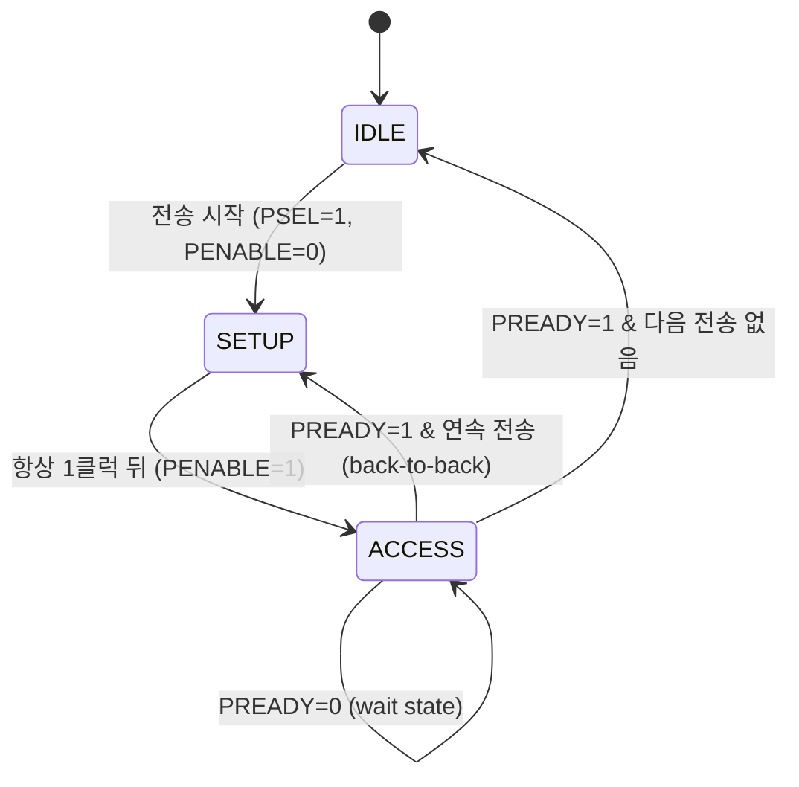

# Unit 1-1 — APB (AMBA의 가장 단순한 버스)

> 핵심 질문: 칩 안의 블록들은 어떻게 서로 데이터를 주고받나? 왜 그 "약속(버스 프로토콜)"이 필요하고, 가장 단순한 APB는 read/write 한 번을 사이클 단위로 어떻게 처리하나?
>
> ※ 이 단원을 읽으며 나온 세부 질문(글리치, setup time, PSEL→PENABLE 2스텝 등)은 별도 페이지 [**`amba-unit1-1-qa.md`**](amba-unit1-1-qa.md) 에 원문 그대로 정리돼 있다.
>
> ※ 파이프라인 버스 AHB는 다음 단원 [Unit 1-2 — AHB](amba-ahb.md) 에서 이어진다.

## 0. 핵심 한 문장

> **AMBA는 "칩 안의 블록들이 데이터를 주고받는 표준 약속(on-chip 버스 프로토콜)"이다.** 그리고 그 약속은 하나가 아니다 — 느린 주변장치엔 *단순한* APB, 빠른 메모리엔 *파이프라인* AHB처럼, **속도와 복잡도의 트레이드오프**에 따라 갈라진다. 이후 AMBA의 모든 진화(AXI, ACE…)는 이 둘에서 "더 빠르게, 더 동시에"로 뻗어나간 변주다.

---

## 1. 왜 버스 프로토콜이 필요한가

### 1-1. 문제 — 블록이 늘어나면 배선이 폭발한다

칩 안에는 CPU, 메모리, DMA, UART, GPIO, 타이머, 가속기… 수많은 블록이 산다. 이들을 **서로 직접 배선(point-to-point)** 으로 다 이으면?

```text
블록 N개를 전부 직접 연결 → 배선 수 ≈ N×(N-1)/2  (조합 폭발)

  CPU ─── MEM
   │ ╲   ╱ │
   │  ╲ ╱  │       4개만 돼도 벌써 6가닥.
  DMA ─── UART     10개면 45가닥. 100개면 4950가닥. → 칩이 배선으로 터짐
```

게다가 블록마다 "나는 이렇게 신호 주고받아"라는 방식이 제각각이면, 새 블록을 붙일 때마다 **번역기(glue logic)** 를 새로 짜야 한다. 재사용이 불가능하다.

### 1-2. 해법 — 공용 버스 + 표준 약속

그래서 **공용 통로(bus)** 를 깔고, 거기 붙는 모든 블록이 **같은 규칙**으로 말하게 한다.

```text
        ┌──────── 공용 버스 (shared interconnect) ────────┐
        │                                                  │
      CPU      MEM      DMA      UART      GPIO            │
        └──────────────────────────────────────────────────┘
   모두 같은 신호·타이밍 규칙(프로토콜)으로 붙음
```

이게 주는 것:

- **재사용성** — 규칙을 지키는 블록(IP)은 어느 칩에든 그대로 꽂힌다. (IP를 사서 붙이는 SoC 비즈니스의 토대)
- **확장성** — 새 블록은 버스 규칙만 지키면 끝. 다른 블록을 안 건드린다.
- **검증 가능성** — 규칙이 명문화돼 있으니 "이 규칙을 어겼나"를 기계적으로 체크(protocol checker)할 수 있다.

### 1-3. 그 "표준 약속"이 곧 버스 프로토콜

버스 프로토콜이 정하는 것:

- **어떤 신호**가 있고 (주소, 데이터, 제어…)
- **언제** 그 신호가 유효하며 (타이밍)
- **누가 누구를 기다리나** (핸드셰이크: "준비됐어?" / "받았어")
- **에러는 어떻게 알리나**

> **한 줄로:** 버스 프로토콜은 블록들 사이의 **언어이자 예절**이다. 무슨 단어(신호)를 언제(타이밍) 말하고, 상대가 들을 때까지 어떻게 기다리는지(핸드셰이크)를 못 박은 것.

---

## 2. AMBA란 무엇인가

> **AMBA (Advanced Microcontroller Bus Architecture) = ARM이 만든 on-chip 버스 프로토콜 표준 "모음".** 단일 프로토콜이 아니라, 용도별로 분화된 패밀리다.

### 2-1. 왜 "하나"가 아니라 "패밀리"인가

블록마다 요구가 극과 극이기 때문이다. GPIO는 1초에 한 번 깜빡이고, DMA는 매 사이클 데이터를 토한다. 이 둘에 같은 버스를 쓰면:

- 빠른 버스를 GPIO에 → 회로·전력 **과잉**.
- 느린 버스를 DMA에 → **병목**.

그래서 AMBA는 **계층(layered bus)** 으로 설계한다.

```text
        ┌──────── 고속 backbone (AXI / AHB) ────────┐
 CPU ──┤   메모리   DMA   고성능 가속기              │  ← 대역폭 중요
        └──────────────┬───────────────────────────┘
                       │  [Bridge] ← 속도·프로토콜 변환
                       ▼
        ┌──────── 저속 주변 (APB) ─────────────────┐
        │  UART   GPIO   Timer   I2C   CSR 블록     │  ← 단순·저전력 중요
        └──────────────────────────────────────────┘
```

> **backbone(백본)** = 칩 안에서 데이터가 가장 많이 흐르는 **중심 간선 버스**(대동맥). 도시의 고속도로처럼, 트래픽이 큰 핵심 경로(CPU↔메모리, DMA)에 빠른 프로토콜을 깔고, 저속 주변장치는 거기서 갈라져 나온 가지(APB)로 내린다.

### 2-2. 버전 히스토리

| 버전 | 연도 | 추가된 것 |
|---|---|---|
| AMBA 2 | 1999 | **AHB**, APB |
| AMBA 3 | 2003 | **AXI3**, AHB-Lite, APB3, ATB(trace) |
| AMBA 4 | 2010 | **AXI4**, AXI4-Lite, **AXI4-Stream**, **ACE/ACE-Lite**, APB4 |
| AMBA 5 | 2013~ | **CHI**, AXI5/ACE5, AHB5, Q/P-Channel(저전력) |

### 2-3. "어디에 뭘 쓰나" 결정표

| 용도 | 프로토콜 |
|---|---|
| 저속 레지스터/주변장치 (CSR, GPIO, timer) | **APB** |
| 중속 메모리/주변 (legacy backbone) | **AHB** |
| 고성능 메모리/마스터 (DMA, CPU↔메모리) | **AXI** |
| 단순 레지스터 slave (경량) | **AXI4-Lite** |
| 주소 없는 데이터 흐름 (DSP/비디오/패킷) | **AXI-Stream** |
| 캐시 일관성 (멀티코어, accel+CPU) | **ACE**(소규모) / **CHI**(대규모) |
| 클럭/파워 게이팅 핸드셰이크 | **Q-Channel / P-Channel** |

### 2-4. 마스터 / 슬레이브 — 기본 용어

- **Master(마스터):** 트랜잭션을 *시작*하는 쪽. 주소를 내고 "읽어/써"라고 명령. (CPU, DMA, 가속기)
- **Slave(슬레이브):** 그 명령에 *응답*하는 쪽. (메모리, 레지스터 블록, 주변장치)
- **Interconnect:** 마스터의 주소를 보고 알맞은 slave로 라우팅하는 중간 매트릭스 (decoder + mux).

> 이 단원의 APB/AHB는 모두 **master가 주도하고 slave가 따라가는** 단방향 명령 구조다. (AXI에서 응답 채널이 독립하며 이 구도가 바뀐다.)

---

## 3. APB — 가장 단순한 버스

> **APB (Advanced Peripheral Bus) = 저속·저전력 주변장치용. 파이프라인도, 버스트도, outstanding도 없다. 한 번에 딱 하나, 최소 2 사이클.**

### 3-1. 설계 철학 — "느려도 되니까 작게"

UART 레지스터 하나 쓰는 데 고속 버스가 필요할까? 아니다. APB는 의도적으로 고급 기능을 **버린다**:

- 트랜잭션이 **항상 하나씩** 순차 (overlap 없음).
- 버스트 없음 — 매 접근이 주소+데이터 한 쌍.
- 핸드셰이크가 단순해 **slave 구현이 거의 공짜** (FSM 몇 줄).
- 그 대가로 **느림**: 전송당 최소 2 사이클.

→ CSR(Control/Status Register) 블록, GPIO, 타이머, 저속 시리얼 IP에 딱.

> **APB의 대표 고객 (자세히는 [Q&A Q2](amba-unit1-1-qa.md))**
> - **CSR 블록 (Control/Status Register):** SW가 HW를 제어/조회하는 레지스터 묶음. Control 레지스터로 명령("켜라/시작"), Status 레지스터로 상태 조회("busy/done/error").
> - **GPIO (General-Purpose Input/Output):** 칩의 범용 핀을 SW로 직접 0/1 읽고 쓰는 블록. 출력(LED), 입력(버튼). DIR/OUT/IN 레지스터 접근.
> - 둘 다 대역폭이 거의 필요 없어 APB에 붙인다.

### 3-2. 신호

| 신호 | 방향 | 설명 |
|---|---|---|
| `PCLK`, `PRESETn` | — | 클럭 / active-low 리셋 |
| `PSEL` | M→S | 이 slave 선택 (디코더가 주소 보고 올림) |
| `PENABLE` | M→S | **ACCESS phase** 표시 (둘째 박자) |
| `PADDR` | M→S | 주소 |
| `PWRITE` | M→S | 1=write, 0=read |
| `PWDATA` | M→S | write 데이터 |
| `PRDATA` | S→M | read 데이터 |
| `PREADY` | S→M | slave 준비 완료 → wait state 생성 (APB3+) |
| `PSLVERR` | S→M | 에러 응답 (APB3+) |
| `PSTRB` | M→S | byte strobe, write 전용 (APB4) |
| `PPROT` | M→S | 보호 속성: priv/secure/inst (APB4) |

### 3-3. 2-phase 구조

APB 전송은 **딱 두 박자**다. 이 FSM이 APB 이해의 90%.

```text
IDLE  →  SETUP  →  ACCESS  →  (IDLE 또는 다음 SETUP)

SETUP  (항상 1클럭): PSEL=1, PENABLE=0  — 주소/제어를 깔아둠
ACCESS (1클럭 이상): PSEL=1, PENABLE=1 — PREADY=1 되는 클럭에 전송 완료
```



> **왜 2박자인가?** SETUP에서 주소를 먼저 안정시키고, 한 박자 늦게 `PENABLE`을 올려 전송 시점을 명확히 하는 것. 단순함을 위해 속도를 양보한 설계다. (자세한 이유 → [Q&A Q6](amba-unit1-1-qa.md))

### 3-4. APB write 한 번, 사이클 단위 추적

`PADDR=0x40`, `PWDATA=0xAB`를 쓰는 single write를 클럭별로 따라가 보자. (wait state 1개 포함)

```text
        T0        T1        T2        T3        T4
        IDLE      SETUP     ACCESS    ACCESS    IDLE
                            (wait)    (전송)

PCLK    ‾|_‾|_    ‾|_‾|_    ‾|_‾|_    ‾|_‾|_    ‾|_

PSEL     0    ___/‾‾‾‾‾‾‾‾‾‾‾‾‾‾‾‾‾‾‾‾‾‾‾\___
PENABLE  0    0      ___/‾‾‾‾‾‾‾‾‾‾‾‾‾‾\___
PWRITE   -    < 1 (write) ................... >
PADDR    -    <    0x40    ................... >
PWDATA   -    <    0xAB    ................... >
PREADY   -    -      0          1          -
                            ↑slave 아직   ↑slave 준비됨
                             안됨(wait)    → 이 클럭에 write 확정
```

| 클럭 | 상태 | 무슨 일이 일어나나 |
|---|---|---|
| **T0** | IDLE | 버스 놀고 있음. `PSEL=0`. |
| **T1** | SETUP | 마스터가 `PSEL=1` 올리고 `PADDR=0x40`, `PWRITE=1`, `PWDATA=0xAB`를 깔아둠. `PENABLE`은 아직 0. **항상 1클럭만 머문다.** |
| **T2** | ACCESS (wait) | `PENABLE=1`로 올림. slave가 아직 못 받아서 `PREADY=0` → **wait state**. 주소·데이터는 그대로 유지(움직이면 안 됨). |
| **T3** | ACCESS | slave가 `PREADY=1`. **이 클럭의 상승 에지에서 write가 실제로 일어난다.** slave 레지스터에 0xAB 기록. |
| **T4** | IDLE | `PSEL=PENABLE=0`. (다음 전송이 있으면 IDLE 대신 바로 SETUP으로.) |

> **핵심:** wait state가 없으면(slave가 즉시 `PREADY=1`) 정확히 **2클럭**(SETUP 1 + ACCESS 1). slave가 느릴 때만 ACCESS가 늘어난다. **SETUP은 절대 안 늘어나고, ACCESS만 늘어난다.** read도 동일한 타이밍이며, ACCESS에서 마스터가 `PRDATA`를 샘플링한다(→ [AHB Q&A Q1](amba-unit1-2-qa.md)).

### 3-5. 한 번의 핸드셰이크 (자세히는 [Q&A Q3](amba-unit1-1-qa.md))

핵심 신호 3개:

| 신호 | 누가 | 의미 |
|---|---|---|
| `PSEL` | 마스터→slave | "**너** 지목한다" |
| `PENABLE` | 마스터→slave | "이제 **진짜 전송**이다" |
| `PREADY` | slave→마스터 | "**받았어/준비됐어**" |

> 마스터가 **`PSEL`(지목) → `PENABLE`(전송 개시)** 로 두 박자에 걸쳐 요청을 내밀고, slave가 **`PREADY`(완료)** 로 답한다. **세 신호가 동시에 1이 되는 클럭**의 상승 에지에서 데이터가 오간다 — 그게 APB의 한 번의 핸드셰이크.

---
## 핵심 정리

- **버스 프로토콜이 필요한 이유:** point-to-point는 배선이 N² 폭발 + 재사용 불가. 공용 버스 + 표준 약속이 재사용성·확장성·검증가능성을 준다.
- **AMBA = ARM의 on-chip 버스 표준 "패밀리".** 블록마다 요구가 달라 단일 프로토콜이 아니라 계층화(APB↔AHB↔AXI…).
- **APB = 2-phase(SETUP→ACCESS).** 주소·데이터를 한 묶음으로, 매 전송 최소 2클럭. SETUP은 항상 1클럭, wait state는 ACCESS만 늘린다.

---

## 🔌 검증 관점

- **APB FSM 위반:** SETUP 없이 ACCESS 진입, ACCESS 중 주소/`PWDATA` 변동, `PENABLE`이 `PSEL` 없이 뜸, `PREADY` 무한 0(deadlock).

---

→ 이 단원을 보며 나온 모든 세부 질문과 답은 [**`amba-unit1-1-qa.md`**](amba-unit1-1-qa.md) 참고. 다음 단원: [Unit 1-2 — AHB](amba-ahb.md).
